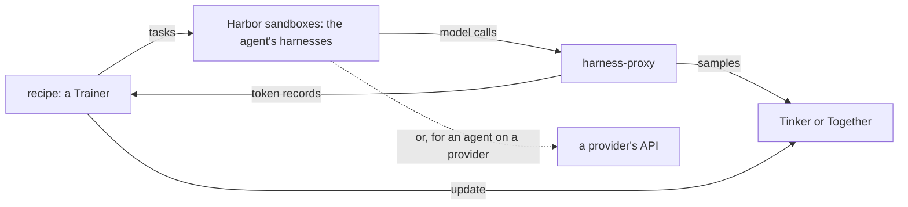

# Shipyard

Post-training framework for AI agents on Harbor tasks.



## Installation

Requires **Python 3.12+** and [uv](https://github.com/astral-sh/uv):

```sh
uv tool install shipyard
```

## Quickstart

```sh
shipyard init                                    # copy the recipes and .env.example here
cp .env.example .env                             # then set your keys in .env
uvx harbor datasets download <dataset> -o tasks  # tasks land in tasks/<dataset>/<task>/
shipyard run recipes/dapo                        # the run writes runs/dapo__<id>/
```

Each recipe's `README.md` says what it needs: keys, dataset and sandbox.

## Customizing

- **Settings:** a recipe's `run.toml` sets the model, harnesses, data, learning rate and LoRA rank.
- **Algorithm:** its `trainer.py` subclasses `Trainer`, whose `step` runs four primitives: `draw`, `rollout`, `score` and `update`. A recipe overrides `score`, `step`, or both (see [`src/shipyard`](src/shipyard/README.md)).
- **Recipes:** DAPO, on-policy distillation and GEPA, in [`recipes/`](recipes/README.md).

The trainer updates on exactly what the agent sampled: `harness-proxy` serves the model to the harnesses, and records every call's token ids and logprobs.

## Layout

```
src/shipyard/            the Trainer API, with models/, jobs/ and run/
packages/harness-proxy/  serves the agent to its harnesses, and records every call
recipes/                 the built-in recipes
```

## License

Apache-2.0. See [LICENSE](LICENSE).
