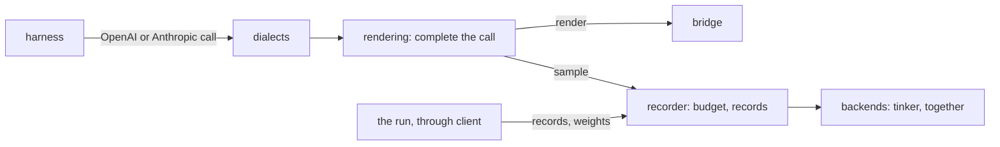

# harness-proxy

A model server that stands in for a provider to agent harnesses: OpenAI Chat Completions and Anthropic Messages, streaming or not, sampled from Tinker or from a Together post-training session. It records every call of every trial as token ids and sampler logprobs, so a trainer can train on exactly what was sampled.



On each call it renders with the model's cookbook renderer, images, PDFs and mid-conversation system messages included; builds the prompt from its own tokens when the history quotes one of its replies; answers an SDK retry with the first reply; returns thinking in the API's own format; and keeps slow streams alive.

## Run it

```bash
harness-proxy --model Qwen/Qwen3-8B --advertise host.docker.internal
```

It serves the model in one lane, named `agent` unless `--lane` names another, prints `serving <lanes> at http://<host>:<port> (control: on)` and serves until SIGTERM. Its tokens come from `HARNESS_PROXY_TOKEN` (the harnesses') and `HARNESS_PROXY_CONTROL_TOKEN` (the run's), or are generated and printed.

| Route | Token | What |
|---|---|---|
| `/r/lane/<lane>/trial/<trial>/v1/chat/completions`, `.../v1/messages` | harness | the lane's model, recorded under `<trial>`; each name percent-encoded, none holding `/` |
| `/r/lane/<lane>/trial/<trial>/renderer/<renderer>/v1/...` | harness | the same, rendered with one of the lane's renderers |
| `/r/trial/<trial>/v1/...` | harness | the only lane, on a proxy with one; refused on one with several |
| `GET /records/<trial>` | control | drains the trial's records, from whichever lane it called (`?delta=1` sends prompts as extensions; `?again=1` resends the last answer) |
| `POST /control/weights` | control | `{"lane": "<lane>", "weights": "tinker://..." \| null}` switches a lane's weights; trial URLs keep working |
| `GET /healthz` | none | each lane: its `model`, what it is `serving`, the per-trial `budget`, and its `renderers` |

## From Python

```python
from harness_proxy.client import Proxy

settings = {"lanes": [{"name": "agent", "model": "Qwen/Qwen3-8B"}]}
proxy = await Proxy.local(settings, host="host.docker.internal")  # or .tunnelled, or .remote
lanes = await proxy.ready()  # each lane's Served, as /healthz reports it
base_url = proxy.address_for("trial-0", lane="agent")  # for the harness, with proxy.token
records = await proxy.records("trial-0")  # harness_proxy.wire.Record, in request order
await proxy.swap("tinker://.../sampler_weights/000010", lane="agent")
proxy.close()
```

- **Lanes:** a proxy serves one or more models, each in a lane of its own, which a call's address names. A run lists them in `--settings` as one document, `{"lanes": [...]}`, each lane whole: a `name`, a `model`, and any of its own `weights`, `renderer`, `temperature`, `top_p`, `top_k`, `max_tokens`, `max_context`, `fill_context`, `metadata`, `backend` and `session`. The proxy fills nothing in. Each lane samples its own weights and records its own calls. `--model`, `--weights` and `--renderer` are shorthand for a document of one lane.
- **Renderers:** a lane's `renderer`, a list, builds each, such as two reasoning efforts; `address_for("trial-0", name, lane="agent")` renders with one. All of them sample the lane's weights.
- **Tunnels:** `Proxy.tunnelled` puts a Cloudflare quick tunnel in front, for sandboxes with no route back (Modal, Daytona). A proxy the run starts stops once the run is gone, leaving no process, port, session or tunnel.
- **Together:** a lane's `backend = "together"` samples the generator of the run's session (`session`): the weights published last, text only, stopping on strings or at the end of sequence. It needs `harness-proxy[together]` and `TOGETHER_API_KEY`.

## Develop

```bash
cd packages/harness-proxy && pytest
```

The tests run on fake samplers and renderers (`tests/proxies.py`); one that needs a real tokenizer skips when it is not cached.
