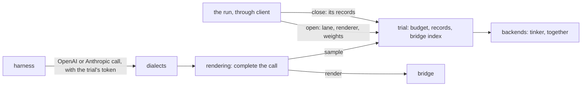

# harness-proxy

A model server that stands in for a provider to agent harnesses: OpenAI Chat Completions and Anthropic Messages, streaming or not, sampled from Tinker or from a Together post-training session. The run opens each trial on it, and closing the trial hands back every call the trial made as token ids and sampler logprobs, so a trainer can train on exactly what was sampled.



On each call it renders with the model's cookbook renderer, images, PDFs and mid-conversation system messages included, encoding each message once per trial; builds the prompt from its own tokens when the history quotes one of its replies; answers an SDK retry with the first reply; returns thinking in the API's own format; and keeps slow streams alive.

## Run it

```bash
harness-proxy --model Qwen/Qwen3-8B --advertise host.docker.internal
```

It serves the model in one lane, named `agent` unless `--lane` names another, prints `serving <lanes> at http://<host>:<port>` and serves until SIGTERM. Its control token, which opens and closes trials, comes from `HARNESS_PROXY_CONTROL_TOKEN`, or is generated and printed.

| Route | Token | What |
|---|---|---|
| `POST /trials` | control | `{"trial": "<name>", "lane": ..., "renderer": ..., "weights": "tinker://..." \| null}` opens a trial and answers `{"token": ...}`; each but `trial` may be left out: the only lane, its first renderer, its base model. The same opening asked again answers the same token |
| `POST /v1/chat/completions`, `/v1/messages` | the trial's | the model of the trial's lane, at its weights, rendered with its renderer, recorded under it |
| `POST /trials/<trial>/close` | control | closes the trial and answers its records, each prompt as a delta of the record it extends; a close asked again within 30 minutes answers the same |
| `GET /healthz` | none | each lane: its `model`, the per-trial `budget`, and its `renderers` |

A call whose token no open trial holds is turned away with a 401, as is a call of a trial that closed. A trial keeps the weights it was opened on until it closes, so trials on several versions of a lane's model run side by side.

By hand, with the control token it printed:

```bash
token=$(curl -s -H "Authorization: Bearer $HARNESS_PROXY_CONTROL_TOKEN" \
  -d '{"trial": "t-0"}' http://localhost:8000/trials | jq -r .token)
OPENAI_BASE_URL=http://localhost:8000/v1 OPENAI_API_KEY=$token my-harness
curl -s -X POST -H "Authorization: Bearer $HARNESS_PROXY_CONTROL_TOKEN" \
  http://localhost:8000/trials/t-0/close
```

## From Python

```python
from harness_proxy.client import Proxy

settings = {"lanes": [{"name": "agent", "model": "Qwen/Qwen3-8B"}]}
proxy = await Proxy.local(settings, host="host.docker.internal")  # or .tunnelled, or .remote
lanes = await proxy.ready()  # each lane's Served, as /healthz reports it
token = await proxy.open("trial-0", lane="agent", weights="tinker://.../sampler_weights/000010")
# the harness dials proxy.address (proxy.local_address from this machine) with `token`
records = await proxy.close("trial-0")  # harness_proxy.wire.Record, in request order
proxy.stop()
```

- **Lanes:** a proxy serves one or more models, each in a lane of its own, which a trial is opened on. A run lists them in `--settings` as one document, `{"lanes": [...]}`, each lane whole: a `name`, a `model`, and any of its own `renderer`, `temperature`, `top_p`, `top_k`, `max_tokens`, `max_context`, `fill_context`, `metadata`, `backend` and `session`. The proxy fills nothing in. A lane needs its model's context length, for the budget and the context fit: its backend reports it, and a lane whose backend cannot must give its own `max_context`, or the proxy refuses to start. `--model` and `--renderer` are shorthand for a document of one lane.
- **Trials:** each samples the weights it was opened on, through a client its lane holds while a trial uses them, and keeps its own records, budget and bridge index until it closes. The run opens and closes trials with the control token; a sandbox holds only its own trial's token.
- **Renderers:** a lane's `renderer`, a list, builds each, such as two reasoning efforts; a trial opened with one is rendered with it.
- **Tunnels:** `Proxy.tunnelled` puts a Cloudflare quick tunnel in front, for sandboxes with no route back (Modal, Daytona). A proxy the run starts stops once the run is gone, leaving no process, port, session or tunnel.
- **Together:** a lane's `backend = "together"` samples the generator of the run's session (`session`): the weights published last, whatever a trial names, text only, stopping on strings or at the end of sequence. It needs `harness-proxy[together]` and `TOGETHER_API_KEY`.

## Develop

```bash
cd packages/harness-proxy && pytest
```

The tests run on fake samplers and renderers (`tests/proxies.py`); one that needs a real tokenizer skips when it is not cached.
