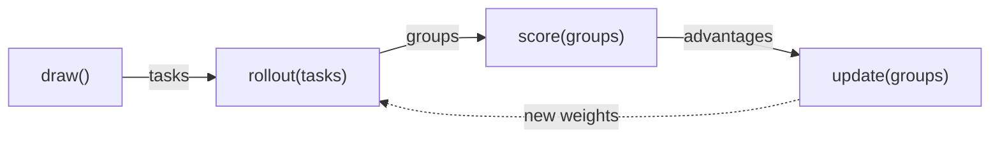

# shipyard

Recipes are implemented as subclasses of `Trainer`. Each step calls `step`, made of four primitives: `draw`, `rollout`, `score` and `update`. A recipe usually overrides `score`, `step`, or both. The trainer does the rest: it binds the models, trains the agent (unless a recipe that never updates sets `self.agent.training = False`), opens the session and the proxy, evaluates, checkpoints, logs and resumes.

| File | Holds |
| --- | --- |
| `trainer.py` | `Trainer`: the four primitives, the default `step`, the run loop, evaluation and checkpoints |
| `model.py` | `Model`, a model the trainer rolls out or scores: what it can do follows from what it is, and `train=True` has the run train it |
| `groups.py` | `Group` → `Trial` → `Sequence`: what a rollout returns, and where advantages go |
| `records.py` | `Records`: what the proxy recorded of a trial's calls, read in one place: the facts a verdict reads, the chains a trial trains on, what its calls cost, and whether a job was served |
| `state.py` | `State`: what a checkpoint saves and a resume restores |
| `config.py` | `Blueprint`, `Recipe`, `load`: a `run.toml`, checked against the recipe |
| `cli.py` | `shipyard init`, `run` and `resume` |
| [`models/`](models/README.md) | the models' backends, the training clients and the run's proxy |
| [`jobs/`](jobs/README.md) | Harbor jobs, harnesses, secrets and verdicts |
| [`run/`](run/README.md) | the run's directory: its logs, costs and checkpoints; and the tasks |