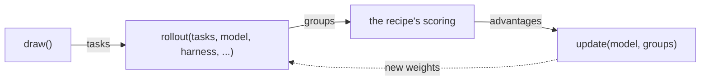

# shipyard

Recipes are implemented as subclasses of `Trainer`. Each recipe writes `step`, from three primitives, `draw`, `rollout` and `update`, and its own scoring; and `evaluate`, when its config has a test set. It reads the models its config names as `self.models[role]` and marks the ones it trains with `training = True`. The trainer does the rest: it opens each model's session and the proxy, takes the steps, evaluates on schedule, checkpoints, logs and resumes.

| File | Holds |
| --- | --- |
| `trainer.py` | `Trainer`: the primitives, the run loop, its evaluation schedule and checkpoints; the recipe writes `step` and `evaluate` |
| `model.py` | `Model`, a model the config names under a role, which the recipe rolls out, scores or trains; `Models`, the trainer's `self.models` |
| `groups.py` | `Group` → `Trial` → `Sequence`: what a rollout returns, and where advantages go |
| `records.py` | `Records`: what the proxy recorded of a trial's calls, read in one place: the facts a verdict reads, the chains a trial trains on, what its calls cost, and whether a job was served |
| `state.py` | `State`: what a checkpoint saves and a resume restores |
| `config.py` | `Config`, `ModelTable`, `Recipe`, `load`: a `run.toml`, checked against the recipe |
| `cli.py` | `shipyard init`, `run` and `resume` |
| [`models/`](models/README.md) | the models' backends, the training clients and the run's proxy |
| [`jobs/`](jobs/README.md) | Harbor jobs, harnesses, secrets and verdicts |
| [`run/`](run/README.md) | the run's directory: its logs, costs and checkpoints; and the tasks |