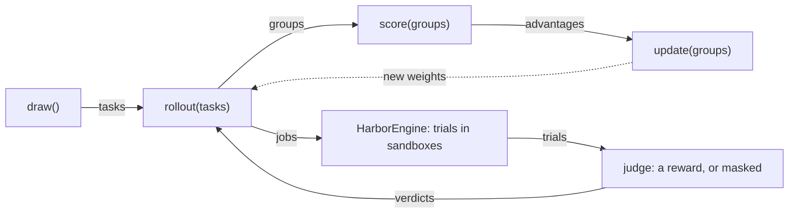

# jobs

Runs the agent on tasks in Harbor sandboxes, and judges each trial. `Trainer.rollout` builds a `Job` and runs it with `HarborEngine`; recipes reach this package only through `rollout`, `keep` and `Modules`.

| Module | Holds |
| --- | --- |
| `engine.py` | `Job`, `HarborEngine`: Harbor's config, the trials, run concurrently, and their records |
| `admit.py` | `Verdict`, `judge`: a trial's reward, or why it is masked |
| `harnesses.py` | `Harness`, `Profile`, `PROFILES`: how each harness reaches the model |
| `secrets.py` | `Pool`, `scrub`: a credential per concurrent trial, scrubbed from its files after |
| `modules.py` | `Modules`, `deliver`: the prompt and skills a trial carries |
| `progress.py` | `Bars`: progress bars, off outside a terminal or with `SHIPYARD_QUIET=1` |