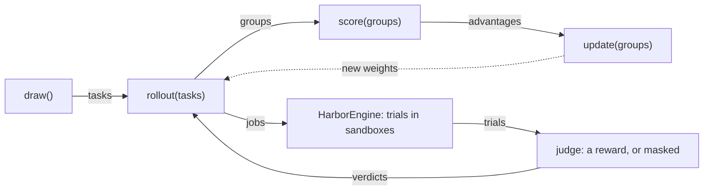

# jobs

Runs the agent on tasks in Harbor sandboxes, and judges each trial. `Trainer.rollout` hands its tasks to `HarborEngine.rollout`, which runs a job per harness and renderer, logs each, checks the endpoint once, and returns the groups; recipes reach this package only through `rollout`, `keep` and `Modules`.

| File | Holds |
| --- | --- |
| `engine.py` | `HarborEngine`: a rollout's jobs (`split`), each `Job`'s trials run concurrently with Harbor, their records, and the groups; `Endpoint`, what a trial's harness dials |
| `admit.py` | `Verdict`, `judge`: a trial's reward, or why it is masked |
| `harnesses.py` | `Harness`: what each harness dials to reach the model, whether it can run with no network, its version, and whether its log says its last call failed; `Profile` and `PROFILES` are its data |
| `secrets.py` | `Pool`, `scrub`: a credential per concurrent trial, scrubbed from its files after |
| `modules.py` | `Modules`, `deliver`, `carried`: the prompt and skills a trial carries |
| `progress.py` | `Bars`: progress bars, off outside a terminal or with `SHIPYARD_QUIET=1` |