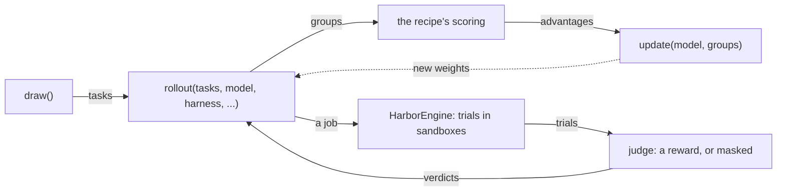

# jobs

Runs a model on tasks in Harbor sandboxes, and judges each trial. `Trainer.rollout` hands its tasks to `HarborEngine.rollout`, which runs them as one job at one harness and renderer, logs it, checks the endpoint served it, and returns a group per task; recipes reach this package only through `rollout`, `keep`, `Harness` and `Modules`.

| File | Holds |
| --- | --- |
| `engine.py` | `HarborEngine`: a rollout's `Job`, its trials run concurrently with Harbor, the groups; `Endpoint`, which opens each trial for its harness to dial and closes it for its records |
| `admit.py` | `Verdict`, `judge`: a trial's reward, or why it is masked |
| `harnesses.py` | `Harness`: a harness as a recipe declares it, its name at an optional version with its env and kwargs; what it dials to reach the model, whether it can run with no network, and whether its log says its last call failed; `Profile` and `PROFILES` are its data |
| `secrets.py` | `Pool`, `scrub`: a credential per concurrent trial, scrubbed from its files after |
| `hooks.py` | `hooks_of`: a task's hooks, read once from its `hooks.py` and checked, which `_run_trial` attaches to every Harbor trial of the task, each run logged |
| `modules.py` | `Modules`, `deliver`, `carried`: the prompt and skills a trial carries |
| `progress.py` | `Bars`: progress bars, off outside a terminal or with `SHIPYARD_QUIET=1` |
| `together.py` | `TogetherEnvironment`: Harbor's environment for `[rollout] sandbox = "together"`, a VM booted from a snapshot of the task's image, built once for each environment's content; `Agent`, the sandbox's own API, called with retries only where a repeat cannot run a command twice |