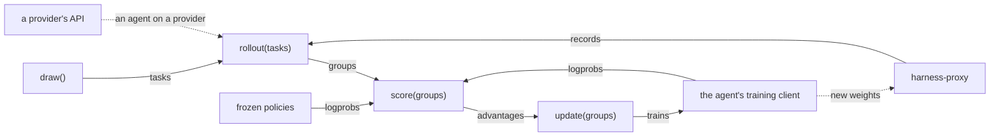

# models

The policies' backends: the agent's training client, frozen samplers, providers' models, and the proxy that serves an agent on a training client to its harnesses. 

| Module | Holds |
| --- | --- |
| `agent.py` | `Session`, `Frozen`, `Provider`: the backends a `Policy` binds to |
| `clients/` | the agent's training client by `[agent] provider` (`client_for`): `TinkerClient`, `TogetherClient` |
| `endpoints.py` | `ProxyEndpoint`, `ProviderEndpoint`: what a trial's harness dials |
| `context.py` | `insert`: text spliced into a sequence just before the task's instruction |