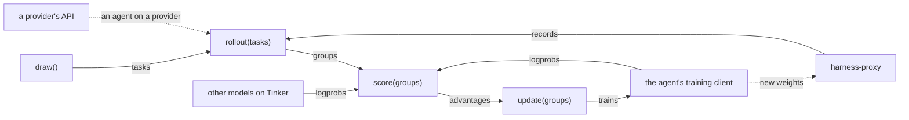

# models

The models' backends: the agent's client, which trains it when the run does, a session of its own for each other model on Tinker, providers' models, and the run's proxy, which serves each model on Tinker or Together to its harnesses in a lane of its own.

| Module | Holds |
| --- | --- |
| `backends.py` | `Session`, `Sampling`, `Provider`: the backends a `Model` binds to; `connect`, which binds them, and `Connected`, which opens them with the run (the other models, the agent's session, then the proxy) and closes them, the proxy first |
| `clients/` | the agent's client by `[agent] provider`, from `CLIENTS` (`client_for`): `TinkerClient`, `TogetherClient`. Each trains the agent, or scores it as it is served, and names who bills its tokens and its backend's kind |
| `endpoints.py` | `ProxyEndpoint`, the run's proxy, with a lane per model on Tinker or Together; `LaneEndpoint`, what a harness dials to reach one, and where its weights are served; `ProviderEndpoint`, a provider's model |
| `context.py` | `insert`: text spliced into a sequence just before the task's instruction |