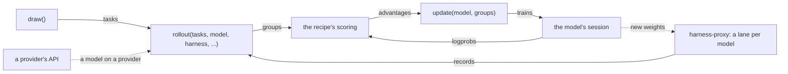

# models

The models' backends: each model on Tinker or Together in a session, which trains it when the recipe does and serves it as it is otherwise; providers' models; and the run's proxy, which serves each model on Tinker or Together to its harnesses in a lane of its own, with its own renderers and sampling.

A `[models.<role>]` table names a base model as its provider serves it, and one adapter on it. Tables that name the same provider and base model are the same served model, in one run and across the runs that start together. Tinker serves every model always. On Together it is a model resource, GPUs billed by the minute: the run starts it as its first session opens, with the sampler replicas its models ask for between them, and stops it as its last closes. The models nobody trains share one session on it, and more adapters than a resource holds are spread over as many resources as they need.

| File | Holds |
| --- | --- |
| `backends.py` | `Session`, `API`: the backends a `Model` binds to; `connect`, which binds them, and `Connected`, which opens them with the run (the models the recipe does not train, then the ones it trains, then the proxy) and closes them, the proxy first; `share`, which places the models of runs that start together before any opens |
| `clients/` | a model's client by its provider, from `CLIENTS` (`client_for`): `TinkerClient`, `TogetherClient`. Each trains the model, from its seed, or scores it as it is served, and names who bills its tokens and its backend's kind. `together.py` also holds `plan`, which places clients on the model resources they share (`Resource`, and `Seat`, the untrained models' one session) |
| `endpoints.py` | `ProxyEndpoint`, the run's proxy, with a lane per model on Tinker or Together; `LaneEndpoint`, which opens each trial of one on the proxy at the weights it serves and closes it for its records, and its sampling; `ProviderEndpoint`, a provider's model |
