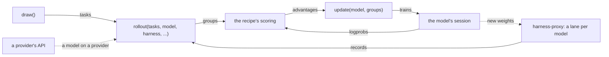

# models

The models' backends: each model on Tinker or Together in a session of its own, which trains it when the recipe does and serves it as it is otherwise; providers' models; and the run's proxy, which serves each model on Tinker or Together to its harnesses in a lane of its own, with its own renderers and sampling.

| File | Holds |
| --- | --- |
| `backends.py` | `Session`, `API`: the backends a `Model` binds to; `connect`, which binds them, and `Connected`, which opens them with the run (the models the recipe does not train, then the ones it trains, then the proxy) and closes them, the proxy first |
| `clients/` | a model's client by its provider, from `CLIENTS` (`client_for`): `TinkerClient`, `TogetherClient`. Each trains the model, or scores it as it is served, and names who bills its tokens and its backend's kind |
| `endpoints.py` | `ProxyEndpoint`, the run's proxy, with a lane per model on Tinker or Together; `LaneEndpoint`, which opens each trial of one on the proxy at the weights it serves and closes it for its records, and its sampling; `ProviderEndpoint`, a provider's model |
