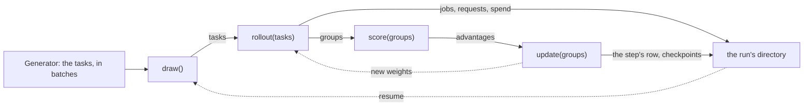

# run

A run's directory and everything it writes: the blueprint, the streams, the costs, the checkpoints and their states. Recipes reach it through `self.metrics`, `keep` and `self.logs.spend`.

| Module | Holds |
| --- | --- |
| `directory.py` | `open_run`, `continued`, `reopened`, `running`, and `trainer_in`, which imports a recipe's folder as its own package |
| `logs.py` | `Logs`: the streams, and their `Wandb` mirror |
| `costs.py` | `Costs`: tokens and sandbox time, totalled from the usage ledger |
| `files.py` | the names of the run directory's files, its atomic JSON writes and JSONL appends |
| `data.py` | `tasks`, `Generator`: Harbor tasks, in resumable batches |